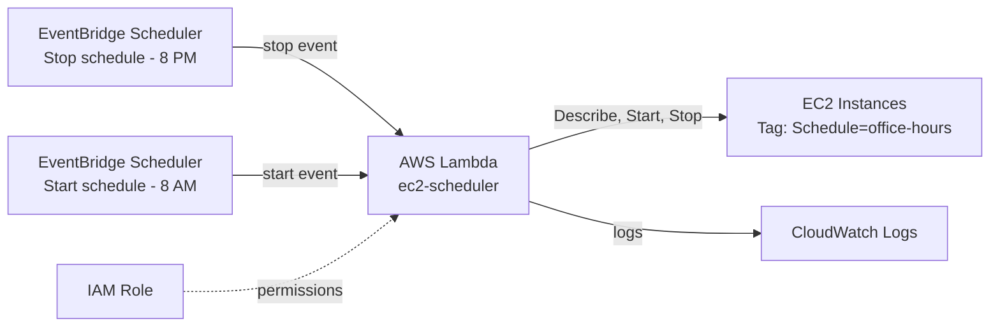

# ⏰ Auto Start/Stop EC2 Scheduler (Cost Saver)

Automatically **stop EC2 instances at night** and **start them every morning** using a serverless scheduler built with EventBridge Scheduler and Lambda. No servers to manage, and almost no cost to run.

> **Level:** Intermediate   |  **Cost:** ~₹0 (within Free Tier, see [Cost](#-cost-and-savings))

---

## 📑 Table of Contents

1. [Overview](#-overview)
2. [Problem Statement](#-problem-statement)
3. [AWS Services Used](#-aws-services-used)
4. [Architecture](#-architecture)
5. [How It Works](#-how-it-works)
6. [Prerequisites](#-prerequisites)
7. [Repository Structure](#-repository-structure)
8. [Step-by-Step Guide](#-step-by-step-guide)
9. [Verification](#-verification)
10. [Cost and Savings](#-cost-and-savings)
11. [Security Best Practices](#-security-best-practices)
12. [Cleanup](#-cleanup)
13. [Troubleshooting](#-troubleshooting)
14. [Future Improvements](#-future-improvements)
15. [What You Will Learn](#-what-you-will-learn)

---

## 📌 Overview

EC2 instances are billed for every hour they are in the **running** state, even when nobody is using them. Development, testing, and college lab servers usually sit idle at night and on weekends.

This project solves that with a small automation:

- At **8:00 PM** → a schedule triggers Lambda → Lambda **stops** all instances tagged `Schedule=office-hours`
- At **8:00 AM** → a schedule triggers Lambda → Lambda **starts** them again

You control which instances are managed simply by adding a **tag**. No code changes are needed.

---

## ❗ Problem Statement

| Without automation | With this project |
|---|---|
| Instances run 24 × 7 (168 hrs/week) | Instances run only 12 hrs on weekdays (60 hrs/week) |
| Someone must remember to stop them | Fully automatic |
| Forgotten servers cause surprise bills | Predictable, lower bills |

Running 60 hours instead of 168 hours per week cuts **compute cost by roughly 64%**.

---

## 🧰 AWS Services Used

| Service | Role in this project |
|---|---|
| **Amazon EC2** | The virtual servers we start and stop |
| **Amazon EventBridge Scheduler** | Triggers the Lambda function at fixed times (cron) |
| **AWS Lambda** | Runs the Python code that finds and starts/stops tagged instances |
| **AWS IAM** | Gives Lambda *least-privilege* permission to manage only tagged instances |
| **Amazon CloudWatch** | Stores Lambda logs and (optionally) raises alarms on failures |

---

## 🏗 Architecture



**Text version:**

```
EventBridge Scheduler (8 PM)  ──┐
                                ├──►  Lambda  ──►  EC2 (tagged instances)
EventBridge Scheduler (8 AM)  ──┘        │
                                         └──►  CloudWatch Logs
```

---

## ⚙ How It Works

1. You tag the EC2 instances you want to automate with `Schedule = office-hours`.
2. **Two EventBridge schedules** exist: one for stopping, one for starting.
3. Each schedule invokes the **same Lambda function** but passes a different input: `{"action": "stop"}` or `{"action": "start"}`.
4. Lambda queries EC2 for instances that match the tag **and** are in the right state (`running` to stop, `stopped` to start).
5. Lambda calls the EC2 API to stop or start them and writes the result to **CloudWatch Logs**.

---

## ✅ Prerequisites

- An AWS account (with billing alerts enabled, see the [Cleanup](#-cleanup) section)
- Basic familiarity with the AWS Console
- Any **EBS-backed** EC2 instance (instance-store instances cannot be stopped)
- Work in **one region** for the whole project (for example `ap-south-1` Mumbai). Everything must be created in the same region.

---

## 📁 Repository Structure

```
aws-ec2-scheduler/
├── README.md                  # This guide
├── lambda/
│   └── lambda_function.py     # Python code for the Lambda function
├── iam/
│   └── lambda-policy.json     # Least-privilege IAM policy
└── screenshots/               # Add your screenshots here
```

---

## 🚀 Step-by-Step Guide

### Step 1: Launch a test EC2 instance and add the tag

1. Open **EC2 → Instances → Launch instances**.
2. **Name:** `scheduler-test-server`
3. **AMI:** Amazon Linux 2023 (Free tier eligible)
4. **Instance type:** `t2.micro` or `t3.micro` (whichever is marked Free tier eligible in your region)
5. **Key pair:** *Proceed without a key pair* is fine for this project (we never log in).
6. Expand **Advanced details / Resource tags** and add:

   | Key | Value |
   |---|---|
   | `Schedule` | `office-hours` |

7. Click **Launch instance** and wait until the state is **Running**.

> ⚠️ Tag keys and values are **case-sensitive**. `Schedule` ≠ `schedule`.

📸 *Add screenshot: `screenshots/01-ec2-tag.png`*

---

### Step 2: Create the IAM policy

Lambda needs permission to find, start, and stop only the tagged instances.

1. Open **IAM → Policies → Create policy → JSON tab**.
2. Paste the contents of [`iam/lambda-policy.json`](iam/lambda-policy.json):

```json
{
  "Version": "2012-10-17",
  "Statement": [
    {
      "Sid": "DescribeInstances",
      "Effect": "Allow",
      "Action": "ec2:DescribeInstances",
      "Resource": "*"
    },
    {
      "Sid": "StartStopOnlyTaggedInstances",
      "Effect": "Allow",
      "Action": [
        "ec2:StartInstances",
        "ec2:StopInstances"
      ],
      "Resource": "arn:aws:ec2:*:*:instance/*",
      "Condition": {
        "StringEquals": {
          "aws:ResourceTag/Schedule": "office-hours"
        }
      }
    }
  ]
}
```

3. **Name:** `EC2SchedulerPolicy` → **Create policy**.

**Why two statements?** `DescribeInstances` does not support resource-level restrictions, so it needs `"*"`. The start/stop actions are restricted by a **tag condition**, so even if the code were changed, Lambda could not touch untagged instances.

📸 *Add screenshot: `screenshots/02-iam-policy.png`*

---

### Step 3: Create the IAM role for Lambda

1. Open **IAM → Roles → Create role**.
2. **Trusted entity:** AWS service → **Lambda**.
3. Attach these two policies:
   - `EC2SchedulerPolicy` (created above)
   - `AWSLambdaBasicExecutionRole` (lets Lambda write logs to CloudWatch)
4. **Role name:** `EC2SchedulerLambdaRole` → **Create role**.

📸 *Add screenshot: `screenshots/03-iam-role.png`*

---

### Step 4: Create the Lambda function

1. Open **Lambda → Create function → Author from scratch**.
2. **Function name:** `ec2-scheduler`
3. **Runtime:** Python 3.12 (or the latest Python available)
4. **Permissions:** *Use an existing role* → `EC2SchedulerLambdaRole`
5. Click **Create function**.
6. In the **Code** tab, replace the default code with [`lambda/lambda_function.py`](lambda/lambda_function.py) and click **Deploy**.
7. Go to **Configuration → General configuration → Edit** and set **Timeout = 30 seconds**.
8. (Optional) Under **Configuration → Environment variables**, you can customise the tag:

   | Key | Value |
   |---|---|
   | `TAG_KEY` | `Schedule` |
   | `TAG_VALUE` | `office-hours` |

   If you skip this, the code uses these same values by default.

📸 *Add screenshot: `screenshots/04-lambda-function.png`*

---

### Step 5: Test the Lambda function manually

Always test before adding schedules.

1. In the Lambda **Test** tab, create a new event named `stop-test` with this JSON:

```json
{ "action": "stop" }
```

2. Click **Test**. Expected response:

```json
{
  "action": "stop",
  "instances": ["i-0123456789abcdef0"],
  "count": 1
}
```

3. Check the EC2 console. The instance should move to **Stopping → Stopped**.
4. Create another test event `start-test` with `{ "action": "start" }` and run it. The instance should return to **Running**.

📸 *Add screenshot: `screenshots/05-lambda-test.png`*

---

### Step 6: Create the EventBridge schedules

We need two schedules: **stop** and **start**.

Open **Amazon EventBridge → Scheduler → Schedules → Create schedule**.

#### 6A. Stop schedule (8:00 PM, Monday to Friday)

| Setting | Value |
|---|---|
| **Name** | `ec2-stop-8pm` |
| **Occurrence** | Recurring schedule |
| **Schedule type** | Cron-based schedule |
| **Cron expression** | `0 20 ? * MON-FRI *` |
| **Time zone** | `Asia/Kolkata` (or your own time zone) |
| **Flexible time window** | Off |
| **Target** | AWS Lambda → **Invoke** → `ec2-scheduler` |
| **Input (payload)** | `{"action": "stop"}` |
| **Execution role** | *Create new role for this schedule* |

#### 6B. Start schedule (8:00 AM, Monday to Friday)

Repeat the same steps with:

| Setting | Value |
|---|---|
| **Name** | `ec2-start-8am` |
| **Cron expression** | `0 8 ? * MON-FRI *` |
| **Input (payload)** | `{"action": "start"}` |

> With these schedules, instances stop on **Friday 8 PM** and start again on **Monday 8 AM**, so weekends are fully off.

**Cron format reminder** (EventBridge Scheduler): `minute hour day-of-month month day-of-week year`

| Goal | Expression |
|---|---|
| Every day at 8 PM | `0 20 * * ? *` |
| Weekdays at 8 AM | `0 8 ? * MON-FRI *` |
| Every day at 11:30 PM | `30 23 * * ? *` |

📸 *Add screenshot: `screenshots/06-eventbridge-schedules.png`*

---

### Step 7 (Optional): Add a CloudWatch alarm for failures

1. Open **CloudWatch → Alarms → Create alarm**.
2. **Select metric → Lambda → By Function Name → `ec2-scheduler` → `Errors`**.
3. Condition: **Static, Greater than or equal to 1**, period 5 minutes.
4. Add an **SNS topic** with your email so you are notified if the scheduler ever fails.

---

## 🔍 Verification

Do **not** wait until 8 PM to find out whether it works.

**Quick demo using a one-time schedule:**

1. Create a new schedule with **Occurrence = One-time schedule**.
2. Set the date and time to about **5 minutes from now** (in your selected time zone).
3. Use the same Lambda target with input `{"action": "stop"}`.
4. When the time arrives, confirm:

| Check | Where | Expected result |
|---|---|---|
| Instance state | EC2 → Instances | `stopped` |
| Lambda ran | CloudWatch → Log groups → `/aws/lambda/ec2-scheduler` | Log line showing the instance ID |
| Schedule invoked | EventBridge → Scheduler → your schedule | Invocation succeeded, no errors |

5. Repeat with `{"action": "start"}` to confirm the instance starts.

📸 *Add screenshot: `screenshots/07-cloudwatch-logs.png`*

---

## 💰 Cost and Savings

**This project itself costs almost nothing:**

- **Lambda:** 2 invocations per working day, far below the free tier.
- **EventBridge Scheduler:** a very generous free tier for invocations.
- **CloudWatch Logs:** tiny log volume.

> Always check the current pricing and Free Tier terms at [aws.amazon.com/free](https://aws.amazon.com/free), since they change over time.

**What you save:**

| Schedule | Hours running / week | Approx. compute saving |
|---|---|---|
| 24 × 7 (no automation) | 168 | 0% |
| 12 hrs/day, 7 days | 84 | ~50% |
| 12 hrs/day, Mon-Fri only | 60 | ~64% |

**Things scheduling does NOT save:**

- 💾 **EBS volumes** still cost money while the instance is stopped.
- 🌐 **Elastic IPs and public IPv4 addresses** can still be charged.
- 🔄 A normal **public IP changes** after every stop/start (use an Elastic IP or DNS if you need a fixed address).
- ⚠️ Data on **instance-store** volumes is lost when stopped.

---

## 🔐 Security Best Practices

- ✅ **Least privilege:** Lambda can start/stop only instances with the matching tag.
- ✅ **No hard-coded credentials:** Lambda uses an IAM role.
- ✅ **Tag-based control:** add or remove the tag to include or exclude an instance, with no code change.
- ✅ **Separate execution role** for EventBridge Scheduler, which only needs permission to invoke this one Lambda.
- ❌ Never attach `AdministratorAccess` or `AmazonEC2FullAccess` to this Lambda just to "make it work".
- ❌ Never tag production databases or critical servers with `Schedule=office-hours` unless you really want them turned off.

---

## 🧹 Cleanup

Delete resources after the workshop to avoid charges:

1. **EventBridge Scheduler:** delete `ec2-stop-8pm` and `ec2-start-8am` (and any one-time demo schedules).
2. **Lambda:** delete the `ec2-scheduler` function.
3. **CloudWatch:** delete the log group `/aws/lambda/ec2-scheduler` (and the alarm, if created).
4. **IAM:** delete the role `EC2SchedulerLambdaRole`, the policy `EC2SchedulerPolicy`, and the auto-created scheduler execution role.
5. **EC2:** **Terminate** `scheduler-test-server`. Stopping is not enough, since the EBS volume still costs money.

---

## 🛠 Troubleshooting

| Problem | Likely cause | Fix |
|---|---|---|
| Lambda returns `count: 0` | Tag key/value mismatch, or the instance is already in the target state | Check the tag spelling and case; confirm the instance state |
| `UnauthorizedOperation` / `AccessDenied` in logs | Policy missing or the tag condition does not match | Re-check the policy and the instance tag |
| Schedule ran at the wrong time | Wrong time zone | Edit the schedule and set the correct time zone (for example `Asia/Kolkata`) |
| Schedule never invokes Lambda | Scheduler execution role cannot invoke the function | Re-create the schedule and choose *Create new role*, or add `lambda:InvokeFunction` for this function |
| Lambda task timed out | Default 3-second timeout | Set the timeout to 30 seconds |
| Instance did not start | It was still `stopping` when start ran, or capacity is unavailable | Run again after it is fully `stopped`; check the logs |
| No logs appear | Role missing `AWSLambdaBasicExecutionRole` | Attach it to the Lambda role |
| `ValueError: Unknown action` | Payload is missing or misspelled | Input must be exactly `{"action": "stop"}` or `{"action": "start"}` |

---

## 🔮 Future Improvements

- 📧 Send an **SNS email/Slack notification** each time instances are stopped or started
- 🌍 Support **multiple regions** with a region list in an environment variable
- 🗄 Extend the scheduler to **RDS databases**
- 🧱 Rebuild the project as **Infrastructure as Code** (CloudFormation, AWS SAM, or Terraform)
- 🏷 Support multiple schedules through tags such as `Schedule=weekdays-9to6` and `Schedule=always-on`
- 📊 Build a CloudWatch dashboard showing how many instance-hours you saved

---

## 🎓 What You Will Learn

- How **event-driven automation** works on AWS
- Writing a **Lambda function** with `boto3`
- Creating **cron schedules** with EventBridge Scheduler (including time zones)
- Applying **IAM least privilege** with tag-based conditions
- Reading **CloudWatch Logs** to debug serverless code
- Practical **cloud cost optimisation** (FinOps basics)

---

## 👥 Contributors

Built by the **AWS Student Builders Group**, **LJIET**.

| Name | Role |
|---|---|
| Mithil Dave | Project author |

---

## 📄 License

This project is for educational purposes. Feel free to fork, learn, and improve it.
